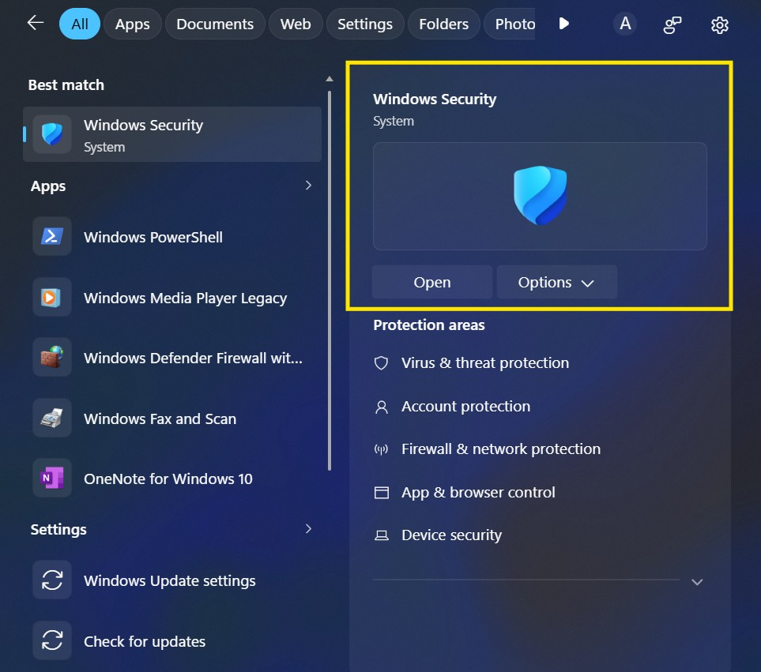
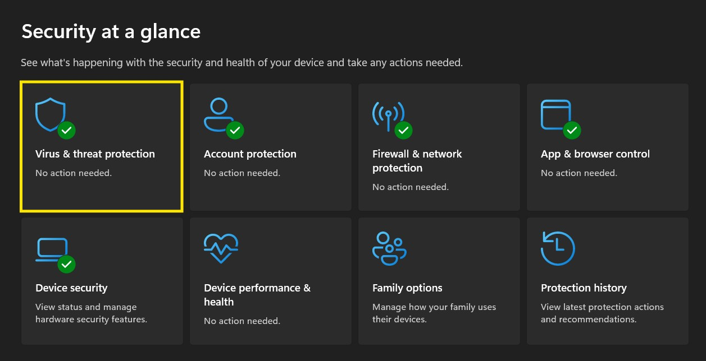
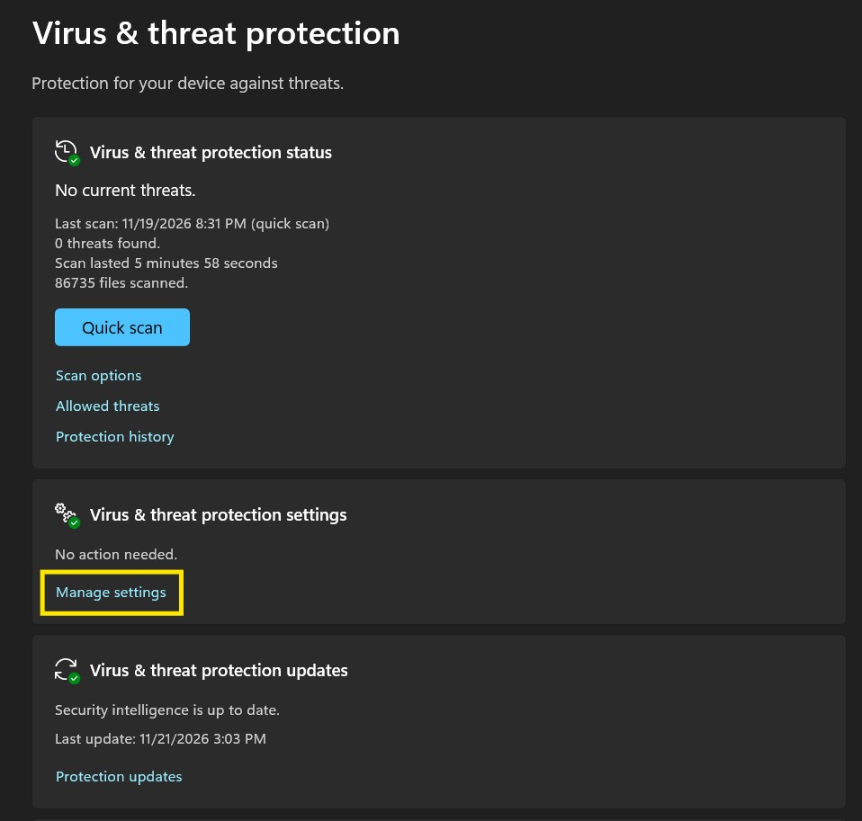
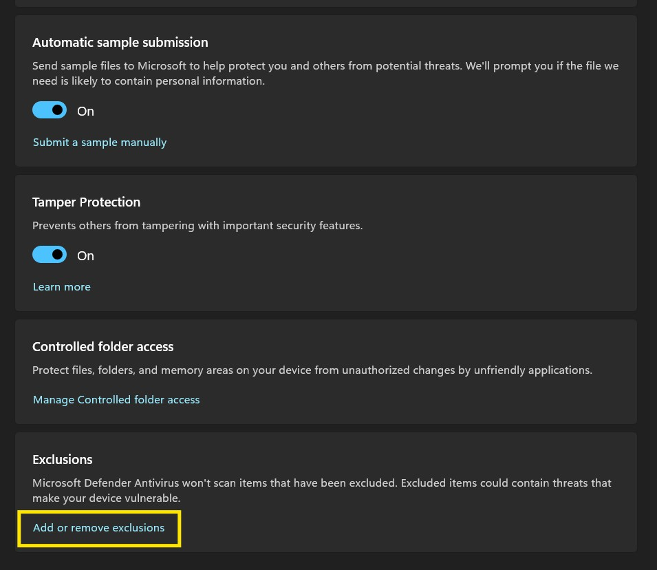
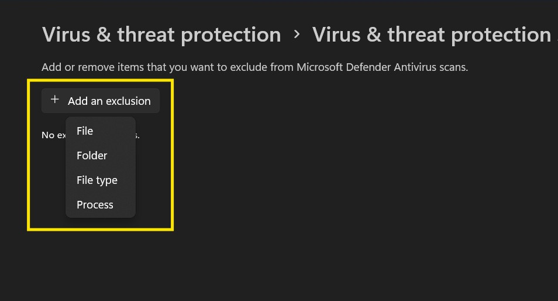

Microsoft Defender Antivirus helps protect Windows by scanning files and monitoring system activity for potential threats. Sometimes, you may need to exclude a trusted file, folder, file type, or process from certain antivirus scans—for example, when troubleshooting a false positive or working in a controlled test environment.

Windows provides a built-in feature called **Exclusions** to manage these exceptions without turning off antivirus protection entirely.

> Antivirus exclusions reduce protection. Only add an exclusion when you understand the risk, and avoid excluding suspicious samples on your everyday Windows computer.
{: .prompt-warning }

## Understanding Exclusion Types

Microsoft Defender supports four main exclusion types:

| Type          | What it excludes                                                                               |
| :------------ | :--------------------------------------------------------------------------------------------- |
| **File**      | One specific file.                                                                             |
| **Folder**    | Files within a selected folder, including its subfolders.                                      |
| **File type** | Files with a selected extension, such as `.log`.                                               |
| **Process**   | Files opened by a specified process from certain scans; **not** the process executable itself. |

For example, `C:\Lab\Samples`{: .filepath } is a folder path, while `.log` is a file extension.

> Choose the narrowest exclusion that solves your problem. A single-file exclusion is generally less risky than excluding an entire folder or file type.
{: .prompt-tip }

## Add or Remove Exclusions in Windows Security

The same menu lets you manage all four exclusion types:

1. Open **Windows Security**.

    {: .light .w-75 .shadow .rounded-10 w='1212' h='668' }
    {: .dark .w-75 .shadow .rounded-10 w='1212' h='668' }

2. Select **Virus & threat protection**.

    {: .light .w-75 .shadow .rounded-10 w='1212' h='668' }
    {: .dark .w-75 .shadow .rounded-10 w='1212' h='668' }

3. Under **Virus & threat protection settings**, choose **Manage settings**.

    {: .light .w-75 .shadow .rounded-10 w='1212' h='668' }
    {: .dark .w-75 .shadow .rounded-10 w='1212' h='668' }

4. Scroll down to **Exclusions** and click **Add or remove exclusions**.

    {: .light .w-75 .shadow .rounded-10 w='1212' h='668' }
    {: .dark .w-75 .shadow .rounded-10 w='1212' h='668' }

5. Select **Add an exclusion**, then choose **File**, **Folder**, **File type**, or **Process**.

    {: .light .w-75 .shadow .rounded-10 w='1212' h='668' }
    {: .dark .w-75 .shadow .rounded-10 w='1212' h='668' }

6. Select the item or enter its value. Approve the administrator prompt if it appears.

To remove an exclusion later, return to the same screen, select its entry, and choose **Remove**.

## Manage Exclusions with PowerShell

You can also manage exclusions from **PowerShell (Run as Administrator)**.

### Add Exclusions

```powershell
# Exclude a specific file
Add-MpPreference -ExclusionPath "C:\Lab\example.txt"

# Exclude a folder and its subfolders
Add-MpPreference -ExclusionPath "C:\Lab\Samples"

# Exclude a file extension
Add-MpPreference -ExclusionExtension ".log"

# Exclude files opened by a process
Add-MpPreference -ExclusionProcess "example.exe"
```

### View Current Exclusions

```powershell
Get-MpPreference | Select-Object ExclusionPath, ExclusionExtension, ExclusionProcess
```

### Remove Exclusions

```powershell
# Remove a file exclusion
Remove-MpPreference -ExclusionPath "C:\Lab\example.txt"

# Remove a folder exclusion
Remove-MpPreference -ExclusionPath "C:\Lab\Samples"

# Remove a file extension exclusion
Remove-MpPreference -ExclusionExtension ".log"

# Remove a process exclusion
Remove-MpPreference -ExclusionProcess "example.exe"
```

> These examples show how the settings work. Do not add every exclusion in the example to your own device; use only the specific exception you need.
{: .prompt-info }

## Security Considerations

- **Avoid broad exclusions:** Entire drives and common file extensions create unnecessary exposure.
- **Keep your host protected:** For malware analysis, store and inspect suspicious samples inside an isolated virtual machine rather than excluding them on your main Windows installation.
- **Review exclusions regularly:** Remove temporary exceptions when they are no longer needed.
- **Know the limits:** An antivirus exclusion does not necessarily bypass other Windows security controls.

> **For malware analysis:** An exclusion is not a security boundary. Proper virtual-machine isolation and clean snapshots matter more than making files easier to access.
{: .prompt-danger }

