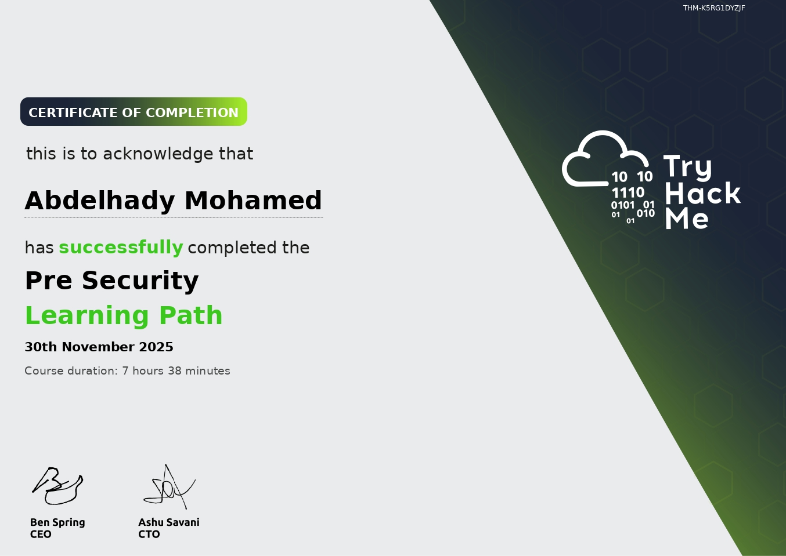
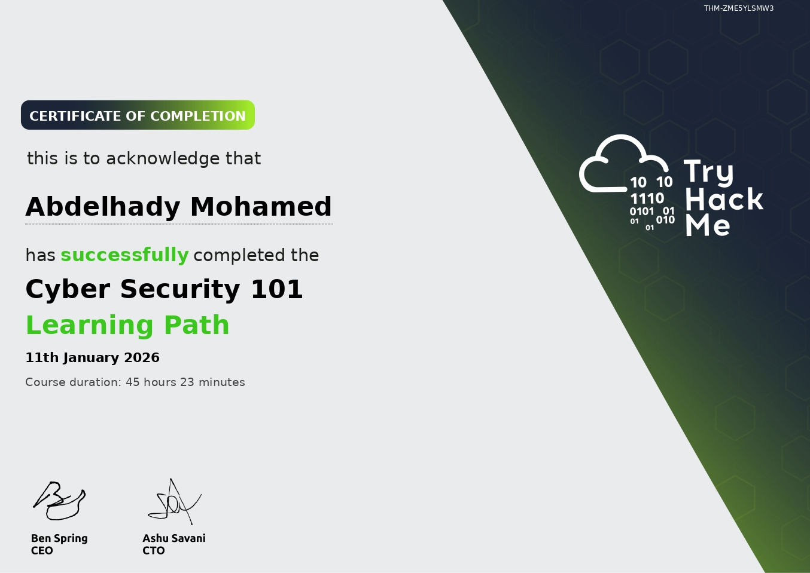

  Interested in web, network, and infrastructure security, with a focus on improving my skills in identifying and analyzing vulnerabilities.
  I have a solid foundation in web application security and network penetration testing, including Active Directory, and I continuously develop my skills through CTF challenges and bug bounty programs.

---

## What I Do

- **Web Application Security** — OWASP Top 10, API Security, Business Logic
- **Network Security** — Active Directory Attacks, Internal Pentesting
- **Bug Bounty Hunting**
- **CTF Participation**

---

## Achievements

| Platform    | Achievement                                |
| ----------- | ------------------------------------------ |
| TryHackMe   | Top 7%                                     |
| PortSwigger | 60% of Web Security Academy Labs Completed |

  

---

## Skills & Tools

| Category        | Technologies / Skills                                      |
| --------------- | ---------------------------------------------------------- |
| Web Security    | Burp Suite, OWASP ZAP, SQLMap, API Testing, Business Logic |
| Network & AD    | Nmap, Metasploit, Active Directory exploitation tools      |
| Scripting       | Python, Bash, PowerShell                                   |
| Web Development | HTML, CSS, JavaScript, PHP, Laravel, REST APIs             |
| Others          | Wireshark, Nessus, Git                                     |

---

## Certifications

    
    
<strong>Pre-Security</strong>

    <a href="/assets/content/certifications/tryhackme/pdf/THM-K5RG1DYZJF.pdf" target="_blank">Certificate view</a>

    
    
<strong>Cyber Security 101</strong>

    <a href="/assets/content/certifications/tryhackme/pdf/THM-ZME5YLSMW3.pdf" target="_blank">Certificate view</a>

---

## Self-Study Courses

- PEN-200 (OSCP) — Course Material · Self-Study
- SEC560 (SANS) — Course Material · Self-Study
- eWPT — Course Material · Self-Study

---

## Completed Training

  
<strong>🟢 TryHackMe</strong>

   
  <table>
    <tr><td style="color: #2ecc71;">▸</td><td>Jr Penetration Tester Path</td></tr>
    <tr><td style="color: #2ecc71;">▸</td><td>Cyber Security 101 Path</td></tr>
    <tr><td style="color: #2ecc71;">▸</td><td>Pre Security (Updated) Path</td></tr>
    <tr><td style="color: #2ecc71;">▸</td><td>Pre Security (Legacy) Path</td></tr>
  </table>

  
<strong>🟠 PortSwigger</strong>

   
  
Completed most core vulnerability labs including:

  <table>
    <tr><td style="color: rgb(204, 154, 46);">▸</td><td>Web LLM attacks</td></tr>
    <tr><td style="color: rgb(204, 154, 46);">▸</td><td>SQL Injection & NoSQL Injection</td></tr>
    <tr><td style="color: rgb(204, 154, 46);">▸</td><td>Cross-Site Scripting (XSS)</td></tr>
    <tr><td style="color: rgb(204, 154, 46);">▸</td><td>Authentication & Access Control</td></tr>
    <tr><td style="color: rgb(204, 154, 46);">▸</td><td>Server-Side Vulnerabilities (SSRF, XXE, SSTI)</td></tr>
    <tr><td style="color: rgb(204, 154, 46);">▸</td><td>API Security & GraphQL</td></tr>
    <tr><td style="color: rgb(204, 154, 46);">▸</td><td>File Upload & Insecure Deserialization</td></tr>
    <tr><td style="color: rgb(204, 154, 46);">▸</td><td>Business Logic Vulnerabilities</td></tr>
    <tr><td style="color: rgb(204, 154, 46);">▸</td><td>HTTP Request Smuggling</td></tr>
  </table>

